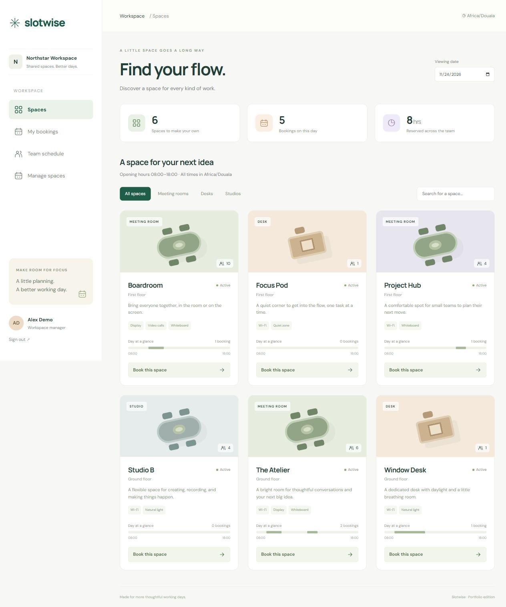

# Local verification

Checked on 24 November 2026 with Python 3.12 and Node.js 24 on Windows.

| Check | Result |
| --- | --- |
| Django booking, authentication, permission, and time-zone suite | 18 passed; one PostgreSQL concurrency test skipped on SQLite |
| Django system checks | No issues |
| Migration drift | No changes detected |
| OpenAPI generation with validation and warnings treated as errors | Passed |
| Ruff Python checks | Passed |
| TypeScript and Vite production build | Passed |
| Frontend dependency audit after installation | No vulnerabilities reported |
| Browser: manager login | Passed |
| Browser: create a future reservation | Passed |
| Browser: reject overlapping reservation | Passed; form retained for correction |
| Browser: filter reservations by day | Passed |
| Browser: cancel a reservation | Passed; status changed to Cancelled |
| Browser: search spaces | Passed |
| Browser: manager creates and archives a space | Passed; archived booking button disabled |
| Desktop viewport | Checked at 1280 × 900 |
| Mobile viewport | Checked at 390 × 844; no document-level horizontal overflow |

[Mobile screenshot](mobile.jpg)

The database concurrency test is included in CI with PostgreSQL 17. It has not been executed locally because this environment does not have a PostgreSQL instance. An unexecuted CI workflow is not a passing CI result.

Screenshots show seeded fictional data. Browser-created verification records remain only in the ignored local SQLite database.
